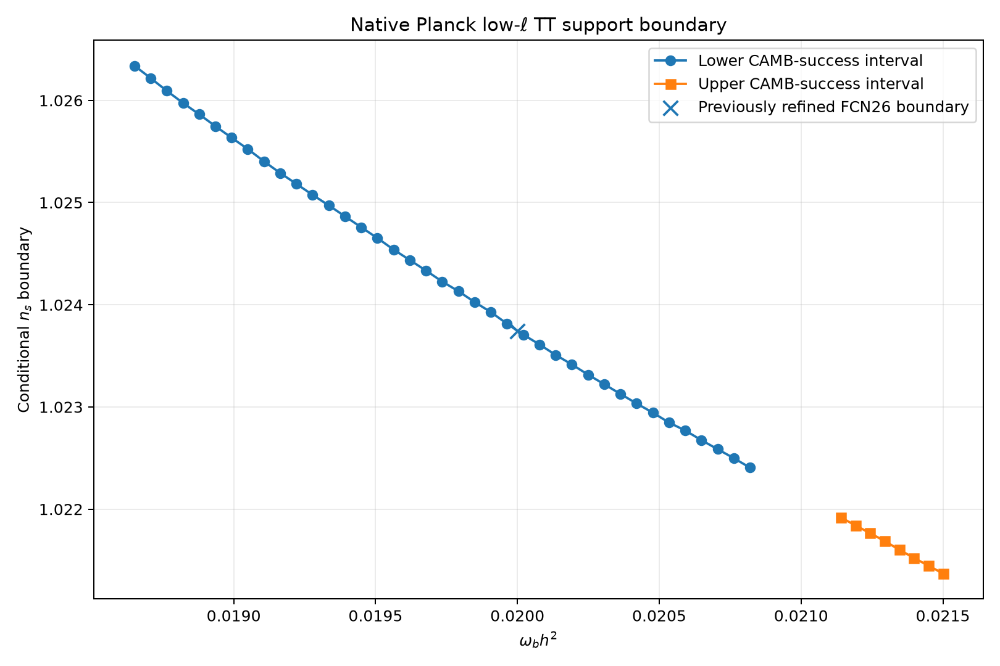

# RFT-Cosmology-Genesis

### An exact spectral invariant, a reduced phenomenological model, and independently tracked cosmological diagnostics

---

## Contents

- [Project at a glance](#project-at-a-glance)
- [Mathematical foundation](#mathematical-foundation)
- [What is implemented](#what-is-implemented)
- [Planck/CAMB research update — 13–14 November 2026](#planckcamb-research-update--1314-november-2026)
- [Reproducibility](#reproducibility)
- [Repository map](#repository-map)
- [Mathematical lineage](#mathematical-lineage)
- [Citation and license](#citation-and-license)

## Project at a glance

**RFT-Cosmology-Genesis** investigates a narrowly defined connection between exact spectral invariants and a reduced phenomenological cosmology model. It also contains a separate, exploratory standard-gravity Planck/CAMB diagnostic study. These are two different research tracks; the Planck/CAMB calculations do **not** fit or constrain the RFT coupling introduced below.

| Track | What is in this repository | Current evidence |
|---|---|---|
| Exact H⁴ input | An SU(2) trace-defect theorem upstream and an independent scalar invariant formalization here | Exact formula and scalar finite-level remainder/convergence are Lean-checked in their respective projects |
| Higher moments | Normalized H⁶/H⁸ diagnostics and H¹⁰ proof-lineage notes | H⁶/H⁸ formulas are implemented and regression-tested; proof boundaries are documented |
| RFT Pass-1 cosmology | A reduced background and acoustic-scale calculation using a phenomenological photon-sector ansatz | Software model and regression tests; no physical derivation of the coupling |
| Planck/CAMB diagnostics | A separate fixed-zero-CDM experiment with native Planck low-ell TT/EE, Plik-lite TTTEEE, and lensing | Conditional numerical scans and likelihood-domain diagnostics; no valid free six-parameter zero-CDM minimum |

> [!IMPORTANT]
> **Research status.** The RFT photon-sector ansatz has not been derived from a covariant action or field equations and is not implemented as a perturbation model in CAMB or CLASS. The zero-CDM Planck/CAMB work is exploratory and has not produced a validated optimized minimum or a statistically calibrated model comparison. No observational constraint on the RFT coupling $\epsilon$ is claimed. This repository does not establish that dark matter is disproved.

## Mathematical foundation

### Graph dimension and H⁴ trace defect

For the Sierpiński-gasket graph at refinement level $m$,

$$
|V_m|=(3^{m+1}+3)/2,\quad N_m=2|V_m|=3^{m+1}+3.
$$

where $N_m$ is the dimension of the two-component SU(2) operator.

The exact fourth-moment trace defect established in [Evgeny's Theorem](https://github.com/RFT-SIRM/Evgeny-Theorem/blob/main/THEOREM.md) is

$$
\Delta_m(H^4,\theta)=-16(3^{m-1}+1)\sin^2(\theta/2),\quad m\geq1.
$$

After normalization by $N_m$, the scalar invariant used in this repository is

$$
I_m(\theta)=-16\frac{3^{m-1}+1}{3^{m+1}+3}\sin^2(\theta/2).
$$

Its exact limit and finite-level remainder are

$$
I_\infty(\theta)=-\frac{16}{9}\sin^2(\theta/2).
$$

$$
I_m(\theta)-I_\infty(\theta)=-\frac{32}{9(3^m+1)}\sin^2(\theta/2).
$$

In particular, at $\theta=\pi/2$,

$$
I_\infty=-\frac{8}{9}.
$$

The scalar formula, exact remainder, decomposition, and convergence are formalized in [CosmologyGenesis.lean](formalization/lean/CosmologyGenesis.lean). The local Lean project does not import the upstream SU(2) operator development; the two formalizations are linked by the stated normalization, not by a shared Lean dependency.

### Pass-1 phenomenological coupling

The model maps the finite-level invariant into a trial photon-sector factor

$$
q_m(\theta,\epsilon)=1+\epsilon I_m(\theta).
$$

This is a **phenomenological ansatz**, not a derived interaction law. The parameter $\epsilon$ is not observationally constrained by the Planck/CAMB experiment documented here. See [MODEL_SPEC.md](MODEL_SPEC.md) and [LIMITATIONS.md](LIMITATIONS.md).

### Higher spectral moments

The H⁶ and H⁸ normalized formulas, exact limits, and finite-level remainders are implemented in [src/spectral_moments.py](src/spectral_moments.py). Their all-level recurrence theorems and exceptional finite base-transition certificates have distinct proof status; the combined formulas are not described as single Lean-kernel theorems.

The H¹⁰ recurrence in Evgeny's Theorem is Lean-proved upstream, but its exact coefficient remains a finite trace expression rather than an expanded trigonometric polynomial. Phi-Genesis contains a **different scalar signed-$Z_2$** H¹⁰ programme; it is not the same operator as the noncommutative SU(2) moments and is not coupled into this cosmology model.

Full formulas, normalization conventions, and proof boundaries are collected in the [Spectral Moment Dossier](SPECTRAL_MOMENT_DOSSIER.md).

## What is implemented

| Component | Implementation | Scope |
|---|---|---|
| H⁴ invariant and Pass-1 coupling | [src/model.py](src/model.py) | Exact scalar invariant and phenomenological factor |
| Background cosmology | [src/cosmology.py](src/cosmology.py) | Expansion history, sound horizon, comoving distance, acoustic scale, and a scaled peak-position proxy |
| H⁶/H⁸ diagnostics | [src/spectral_moments.py](src/spectral_moments.py) | Normalized finite-level formulas, limits, and remainders |
| Scalar Lean formalization | [formalization/lean/CosmologyGenesis.lean](formalization/lean/CosmologyGenesis.lean) | H⁴ scalar identity, remainder, decomposition, and convergence |
| Python regression suite | [tests/](tests/) | Invariant, spectral-moment, and reduced-background checks |

The background calculator is not a full Boltzmann solver. It does not calculate recombination perturbations, diffusion damping, or the full TT/TE/EE spectra.

## Planck/CAMB research update — 13–14 November 2026

This is a **separate standard-gravity diagnostic track**. The tested external configuration fixed $\omega_c h^2=0$, used lens_potential_accuracy = 0, and evaluated:

- Planck 2018 native low-$\ell$ TT;
- Planck 2018 native low-$\ell$ EE;
- native Plik-lite TTTEEE (not the full Planck Plik likelihood);
- native Planck lensing.

The external environment was Python 3.14.2, CAMB 2.0.5, Cobaya 3.6.2, iminuit 2.33.0, NumPy 2.5.4, and SciPy 1.18.1. These external likelihood calculations are not run by the repository's ordinary pytest suite.

### 1. Best observed conditional zero-CDM grid point

A refined $3\times3\times3$ conditional grid produced a best observed point with all four likelihood components finite:

| Parameter | Value |
|---|---:|
| $H_0$ | 100.0 (upper prior boundary) |
| $\omega_b h^2$ | 0.01885 |
| $\omega_c h^2$ | 0 (fixed) |
| $A_s$ | $0.990\times10^{-9}$ |
| $n_s$ | 1.026 |
| $\tau$ | 0.24195 |
| $A_{\rm planck}$ | 1.0008 |

$$
-\log P=71202.82490850563,\quad \chi^2_{\rm CMB}=142454.95099736075.
$$

| Likelihood contribution | $\chi^2$ |
|---|---:|
| Planck low-$\ell$ TT | 175.662245228572 |
| Planck low-$\ell$ EE | 435.067184170785 |
| Native Plik-lite TTTEEE | 132375.342744373309 |
| Native Planck lensing | 9468.878823588093 |
| **Total** | **142454.950997360750** |

The same point was independently re-evaluated in two fresh Cobaya model instances, with identical displayed values. It is still only the **best observed point in a conditional grid**, not a jointly optimized fit or a global minimum. $H_0$ lies at the upper prior boundary, and the large Plik-lite contribution dominates the total.

### 2. MIGRAD failure diagnosis

Raw evaluations with make_finite = False and cached = False showed that the two replayed maximum-float objective points were rejected by the native low-$\ell$ TT spline-domain check. The prior, CAMB theory, low-$\ell$ EE, Plik-lite TTTEEE, and lensing evaluations were finite.

| Trial | Native TT domain result | Diagnosis |
|---|---|---|
| FCN24 | 18 of 28 multipoles below lower spline bounds | Rejected by native low-$\ell$ TT |
| FCN25 | Only $\ell=15$ below its lower bound | Rejected by native low-$\ell$ TT |
| FCN26 control | All 28 multipoles inside bounds | Finite control point |

At FCN25, the calibrated theory value at $\ell=15$ was 372.5417141618 against a lower spline bound of 386.8925568207 (margin $-14.3508426589$). At FCN26, the closest margin was $+4.285950904695$.

This identifies the likelihood component responsible for those two raw rejections. It does **not** establish why Minuit later generated non-finite internal coordinates; that separate optimizer failure remains unresolved.

### 3. One-dimensional native TT boundary

With the other parameters fixed at the FCN26 control point, a bisection scan found the conditional support boundary

$$
n_s^\ast=1.02374434007214.
$$

at $\omega_b h^2=0.01999994830543$, $H_0=99.99$, and $\omega_c h^2=0$. The transition is controlled by the lower native TT spline bound at $\ell=15$. A change of $10^{-7}$ to either side changes the raw native TT result from finite to $-\infty$.

This is a conditional boundary for one fixed-parameter slice, not a universal upper limit on $n_s$, a prior bound, or a physical exclusion.

### 4. Completed two-dimensional conditional boundary map

The subsequent scan varied only $n_s$ and $\omega_b h^2$, holding the other parameters fixed at FCN26. It produced 47 refined inside/outside brackets, with $10^{-9}$ stopping tolerance in $n_s$:

| CAMB-success branch | $\omega_b h^2$ interval | Samples | $n_s^\ast$ at branch endpoints |
|---|---:|---:|---:|
| Lower | 0.01865–0.02082 | 39 | 1.0263391817 → 1.0224061117 |
| Upper | 0.02114–0.02150 | 8 | 1.0219192147 → 1.0213708216 |

**All 47 transitions are controlled by the lower native TT spline bound at $\ell=15$.** At every accepted inside point, all four likelihood components (low-$\ell$ TT, low-$\ell$ EE, Plik-lite TTTEEE, and lensing) were finite. The complete inside/outside brackets are available in the [47-row CSV dataset](research/data/conditional_lowell_tt_boundary_2026-11-14.csv).

For compact description only, let $x=\omega_b h^2-0.02$. Separate empirical regressions on the two disconnected branches are

$$
n_s^\ast\approx122.0075971x^2-1.746349867x+1.02375269.
$$

$$
n_s^\ast\approx-1.532107716x+1.023667508.
$$

The RMS residuals are $6.30817\times10^{-6}$ and $2.31827\times10^{-6}$, respectively. These are descriptive interpolants over the sampled intervals, **not physical laws or global parameter constraints**; no polynomial was fitted across the CAMB-failure gap.

### 5. CAMB recombination-domain gap

On this same fixed-parameter slice, CAMB had a low-$\omega_b h^2$ failure below the observed success boundary near 0.018632091697280515. It succeeded through 0.020837989546081976, then failed in a central interval whose sampled edges were approximately 0.020837989546081979 to 0.021125541386001472, and succeeded again from approximately 0.021125541386001475 (tested through 0.0215).

This is a **CAMB recombination-calculation failure region for the tested slice**. It was not interpolated across and is not a Planck likelihood rejection or a physical exclusion.

### 6. Scientific interpretation

The 13–14 November work establishes a reproducible conditional grid point, identifies the native TT spline-domain rejection in two MIGRAD trial evaluations, and completes the 47-point two-dimensional conditional boundary map.

It does **not** establish:

- a valid free six-parameter zero-CDM minimum;
- a statistically calibrated comparison or exclusion of zero CDM;
- a global upper bound on $n_s$;
- an observational constraint on the RFT coupling $\epsilon$;
- a full Planck Plik analysis (the tested high-$\ell$ likelihood was native Plik-lite).

The conditional boundary-mapping stage is complete. Repeating that same scan is not the next research step. The full methods, raw point table, limitations, and dated experiment log are in the [Planck/CAMB research checkpoint](research/PLANCK_CMB_CHECKPOINT_2026-11-13.md).

## Reproducibility

### Repository tests

From the repository root:

    python3 -m venv .venv
    source .venv/bin/activate
    pip install -r requirements.txt
    python -m pytest -q

The recorded local baseline is **58 passed**. The [GitHub Actions CI workflow](https://github.com/RFT-SIRM/RFT-Cosmology-Genesis/actions/workflows/ci.yml) runs the Python test suite. The separate Lean workflow builds the scalar H⁴ formalization when Lean sources or its workflow change.

### Scope of the external Planck/CAMB experiment

The Planck data package, likelihood configuration files, external virtual environment, and raw Cobaya logs are kept outside this repository. They are not silently presented as part of the test suite. The committed checkpoint records the tested versions, likelihood definitions, conditional values, failure diagnostics, and interpretation limits; the refined boundary table and plot are committed alongside it.

## Repository map

| File | Purpose |
|---|---|
| [EXACT_INVARIANT_REMAINDER_THEOREM.md](EXACT_INVARIANT_REMAINDER_THEOREM.md) | H⁴ scalar invariant, exact remainder, and Lean proof boundary |
| [SPECTRAL_MOMENT_DOSSIER.md](SPECTRAL_MOMENT_DOSSIER.md) | H⁶/H⁸/H¹⁰ formulas, normalization, and cross-project proof boundaries |
| [MODEL_SPEC.md](MODEL_SPEC.md) | Pass-1 assumptions and phenomenological definitions |
| [RESULTS.md](RESULTS.md) | Reproducible software results and acoustic-scale baseline |
| [RESEARCH_STATUS.md](RESEARCH_STATUS.md) | Established results, open questions, and evidence status |
| [LIMITATIONS.md](LIMITATIONS.md) | Physical, numerical, and inferential limitations |
| [research/PLANCK_CMB_CHECKPOINT_2026-11-13.md](research/PLANCK_CMB_CHECKPOINT_2026-11-13.md) | Full dated Planck/CAMB diagnostic record |
| [research/data/conditional_lowell_tt_boundary_2026-11-14.csv](research/data/conditional_lowell_tt_boundary_2026-11-14.csv) | All 47 conditional boundary brackets |
| [research/figures/conditional_lowell_tt_boundary_2026-11-14.png](research/figures/conditional_lowell_tt_boundary_2026-11-14.png) | Boundary-map figure |

## Mathematical lineage

Only the following two repositories are directly relevant to the mathematical lineage described here:

- **[Evgeny's Theorem](https://github.com/RFT-SIRM/Evgeny-Theorem)** — upstream noncommutative SU(2) trace-defect theorems, including the exact H⁴ input and higher-moment recurrences.
- **[Phi-Genesis](https://github.com/RFT-SIRM/Phi-Genesis)** — a separate Sierpiński-graph spectral project, including a scalar signed-$Z_2$ H¹⁰ programme. Its operator and proof status must not be conflated with the SU(2) moments or with this cosmology model.

These are **research-lineage references, not software dependencies** of the Python or Lean projects in this repository. The QPU architecture and invariant-battery projects are not dependencies or mathematical inputs to this cosmology codebase and are intentionally not listed as related repositories.

## Authorship and correspondence

**Evgeniy Zaprudnov**  
*Research author · RFT-SIRM*

For research correspondence, use [evgeniyzaprudnov@gmail.com](mailto:evgeniyzaprudnov@gmail.com?subject=RFT-Cosmology-Genesis%20research%20enquiry). For machine-readable author and citation metadata, see [CITATION.cff](CITATION.cff).

---

## Citation and license

- Citation metadata: [CITATION.cff](CITATION.cff).
- License: [Apache License 2.0](LICENSE).

For corrections, reproducibility reports, or research questions, please use the repository's [Issues](https://github.com/RFT-SIRM/RFT-Cosmology-Genesis/issues) and [Pull Requests](https://github.com/RFT-SIRM/RFT-Cosmology-Genesis/pulls).
